# Cloud Computing Essentials

## *Overview*

***Create Static Website useing S3 bucket***

## *Services Used*

- S3 Bucket

## *Architecture*

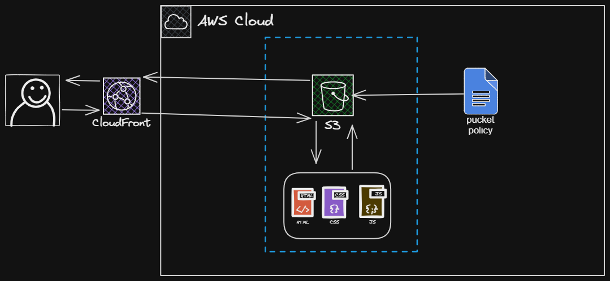

## *Steps*

1. **Type in searchbar s3**

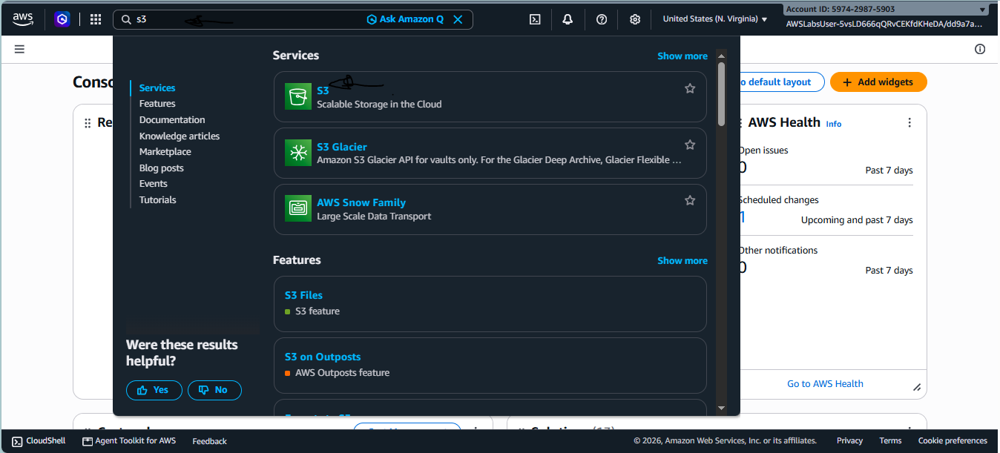

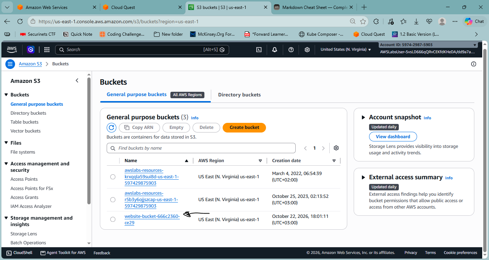

1. **Rename index.html to waves.html**

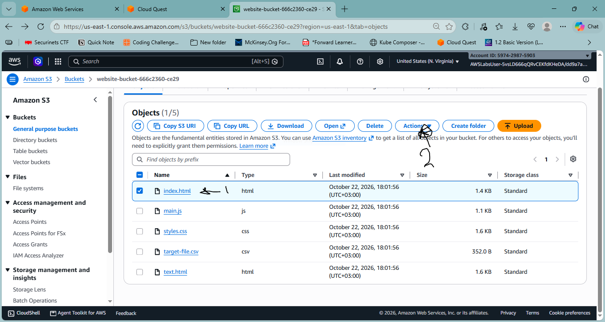

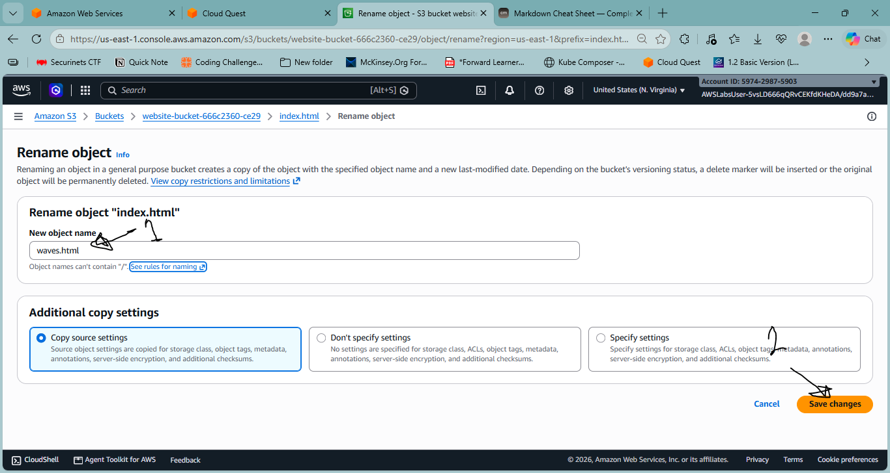

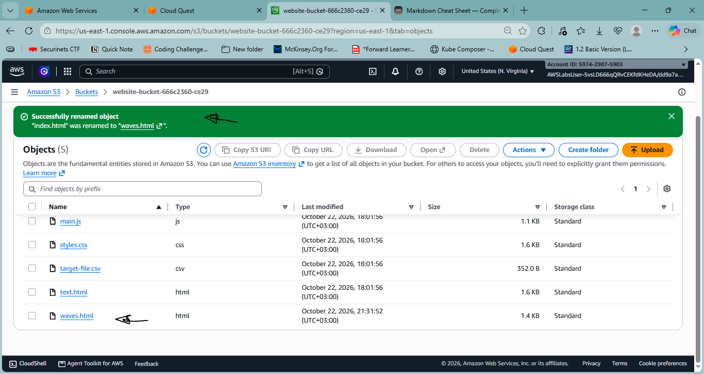

1. **Enable static website in s3**

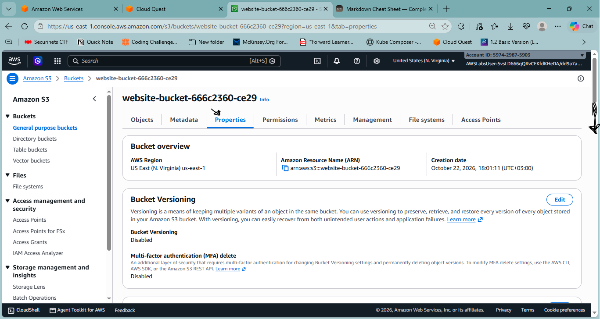

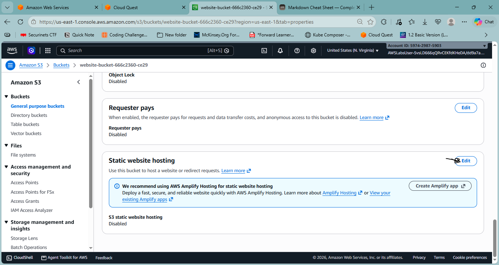

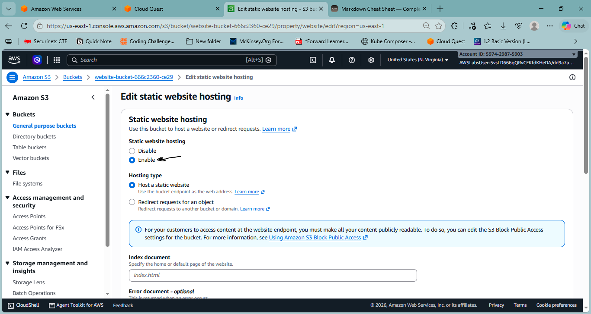

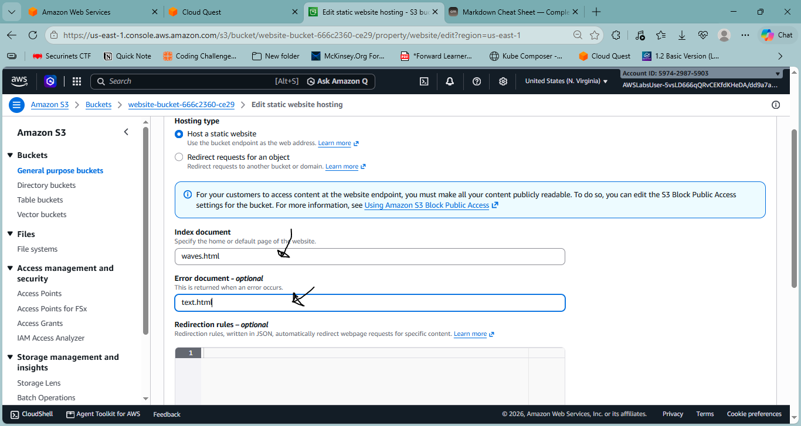

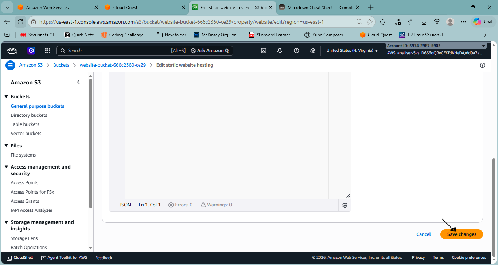

1. Validation

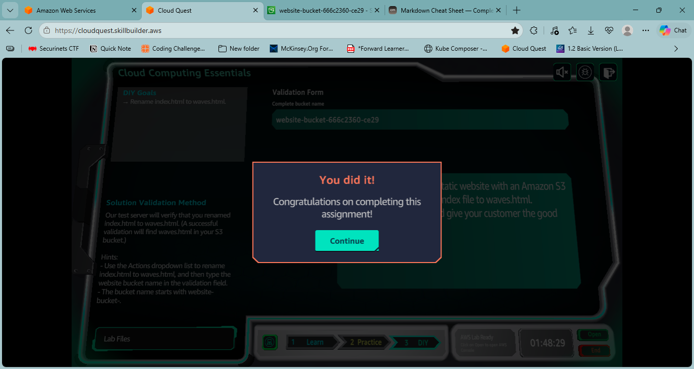